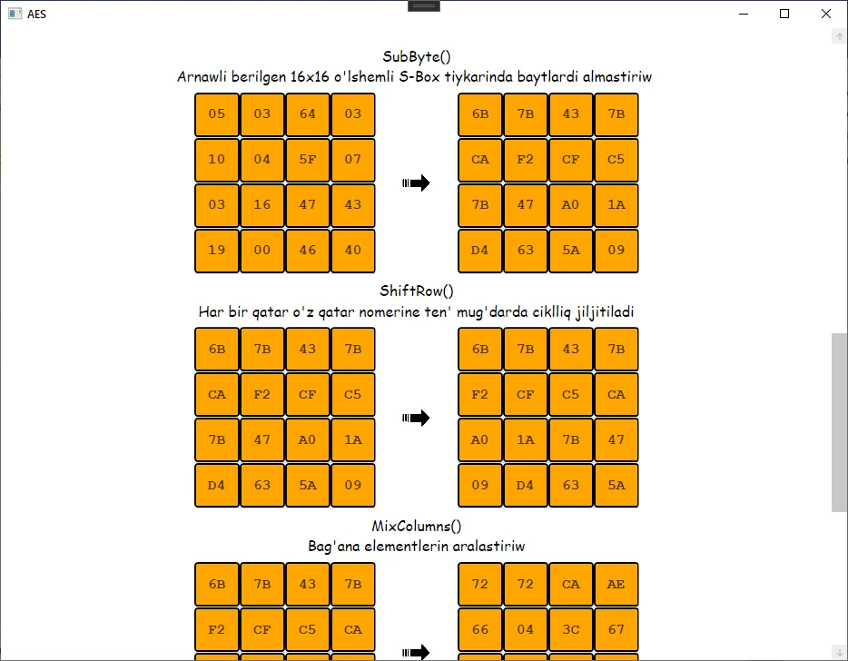
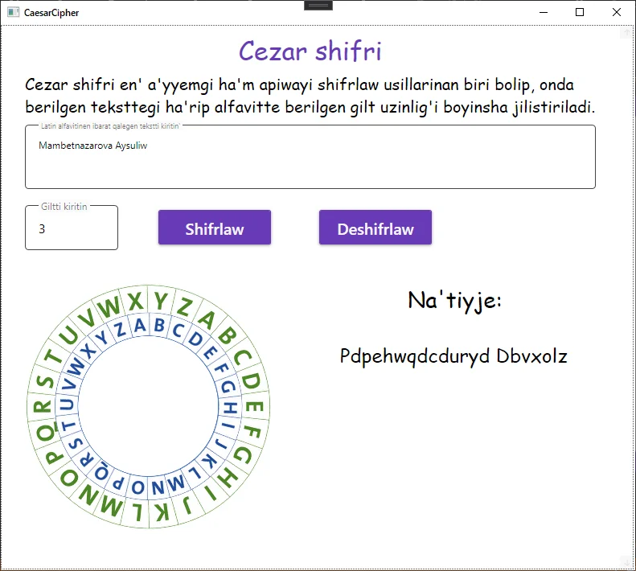
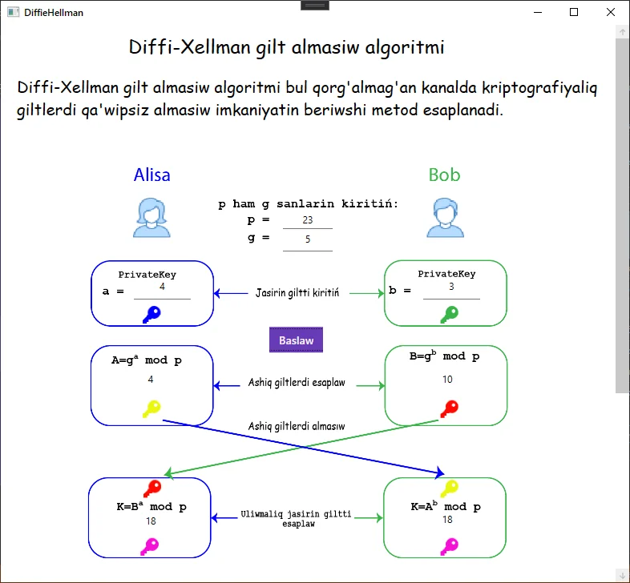
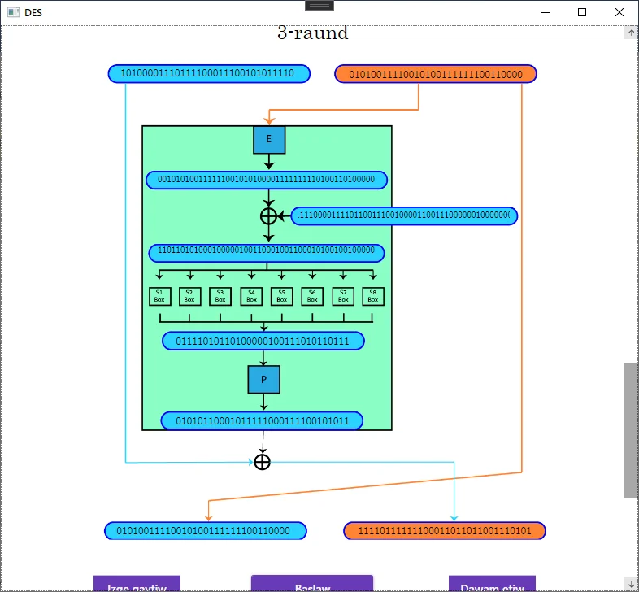
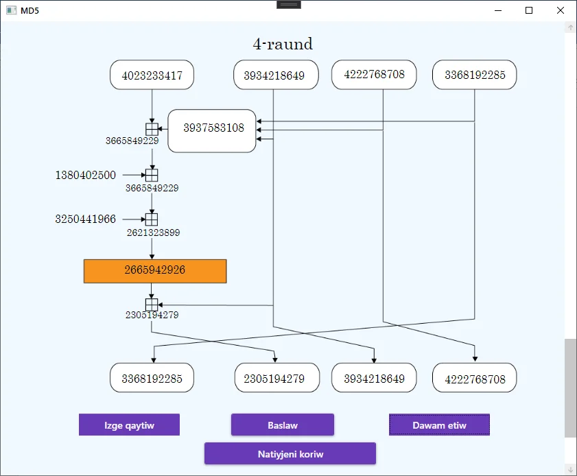

# CryptoApp

An interactive Windows app that shows how cryptographic algorithms work inside,
step by step: you enter a message and a key, press encrypt, and watch every round.

My bachelor's thesis project (2021, B.S. in Information Security,
Tashkent University of Information Technologies, Nukus branch).
The interface is in Karakalpak.

## What it covers

| Section | Algorithms | What you see |
|---|---|---|
| Classical | Caesar, ROT13, Atbash, Vigenère | A rotating alphabet wheel, letter mappings, the Vigenère table with the path highlighted |
| Symmetric | AES-128, DES | Key schedule, then each round on the state: SubBytes, ShiftRows, MixColumns, AddRoundKey for AES; the 16 Feistel rounds for DES |
| Asymmetric | RSA, Diffie-Hellman | The key exchange between Alice and Bob, value by value |
| Hash functions | MD5, SHA-1, SHA-256 | Padding bit by bit, then each round's buffers, with back and forward buttons |

Every algorithm is implemented by hand (S-boxes, permutation tables, round constants),
not called from a library, because the point is to show the intermediate values a
library never exposes.

| | |
|---|---|
|  |  |
|  |  |

## Built with

C#, WPF (.NET Framework 4.7.2), XAML, Material Design in XAML.

## Run it

Open `CryptographyApp/CryptographyApp.sln` in Visual Studio on Windows, restore NuGet packages and run.

## Note

This is a teaching tool. The implementations are written to be readable and visual, not
constant-time or hardened. For real encryption, use a vetted library.
